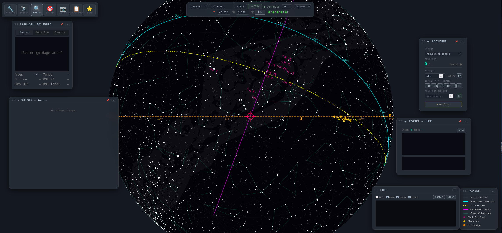

# 3 · Focuser — get focus 🔍
{: .fs-6 }

Panels: **Focuser** (position / speed / moves) + **Focus — HFR** + **Autofocus V-curve**.

*Focuser mode: current/target position and bar, speed, relative/absolute moves, HFR and V-curve graphs below.*

## Step-by-step

1. Pick the **camera** (if several) at the top of the Focuser panel.
2. Set **speed** (`steps/s`, `OK`) then nudge by `−1000/−100/−10 / +10/+100/+1k` or type an **absolute position** → `GO`. Cyan bar tracks target; `● MOVING` lights while moving. `⏹ Abort` = `FOCUSER_ABORT_MOTION`.
3. **Focus — HFR**: each frame feeds the `HFR vs position` graph (320×100 canvas) + history (60 px). `Steps` and `Best` increment; `Reset` clears series.
4. **Autofocus V-curve**: set `Range` (steps, e.g. 2000) and `Points` (25) → `▶ Run`. The V-curve measures **HFR** at each step, fits a parabola, returns to **Best** and verifies. Progress `0/25`, `HFR: — / Pos: —` live.

{: .note }
> **Astro deep-dive — HFR & V-curve**
> **HFR** (half-flux radius) = radius holding half a star's flux: minimum at focus, linear either side → V shape. Good autofocus needs: unsaturated star (peak < `saturation_frac` ~60 % full well), short exposure (`exposure.target_bg` ~4000 ADU above bias), stable seeing. 25 pts / 2000 steps → ~80 steps/point: time/accuracy trade-off.
> → [HFR sheet](../astrotech/hfr.html)

## Auto-refocus in sequence

In Sequencer: `Auto-refocus` fires between two exposures if `interval_min` (minutes) **or** `Δ altitude` (°) exceeded — never on the 1st exposure (baseline). A failed refocus does not stop the sequence (warning).

## Manual focus (no motorized focuser)

**✋ Manual focus** panel (Focuser mode, bottom left): turn the knob by hand, Noctua measures.

1. `Exp` (s) → `📏 Measure` (HFR on the last image) or `🔁 Loop` (looping exposures + auto measure each round, `⏹ Stop` to end). The Loop measures **from the JPEG preview** (~4 s/round, no wait for the full FITS): turn the knob between rounds. Nothing is ever sent to the focuser — works with no focuser attached.
2. Each measurement feeds the **HFR** chart (`Focus — HFR`): drive the curve down to its minimum.
3. **Bahtinov mask**: `▦ Bahtinov: ON`, then click a bright star in the preview → Noctua detects the 3 spikes (Radon) and shows `Δ ±N px → ⟩⟩/⟨⟨` + segments on the overlay. Turn the knob to bring Δ near 0 (`◎ In focus!` under ±2 px, green chips in the history). `⇄` flips the indicated direction if your mask mounting requires it (remembered). In `Loop`, the same star is re-analysed every exposure.
4. **Linear view** (`◐ Linear`, remembered): autostretch lies about star profiles; for focusing the full FITS is shown in pure linear (black = sky background, white = max pixel, full dynamics), fetched over HTTP on each new image. Essential to judge focus, saturation or a spike.

{: .note }
> **Astro-technique — reading the Bahtinov**
> In focus, the central spike crosses exactly the intersection of the two diagonals. Out of focus it shifts sideways — the sign (intra/extra-focal) depends on mask orientation, hence the `⇄` button: if the reading grows while you follow the arrow, flip once for the session. Backend: `indigo/devices/bahtinov.py` (`GET /api/focuser/bahtinov`), endpoint tested on synthetic stars (±8 px offsets recovered within 1 px).

{: .warning }
> **Pitfalls** — HFR *rising* instead of falling: focuser reversed (`IN/OUT`), saturated or double star, wind. Check preview 1:1. If focuser stalls: `ABORT` then `GO` with lower speed.

## 📷 Coming soon

* Photo `focuser-vcurve-best.png` — finished V-curve with `Best: 12480 / HFR 1.42`
* Photo `focuser-hfr-history.png` — HFR history over 30 min periodic refocus

> 🇫🇷 [Version française]({{ site.baseurl }})
